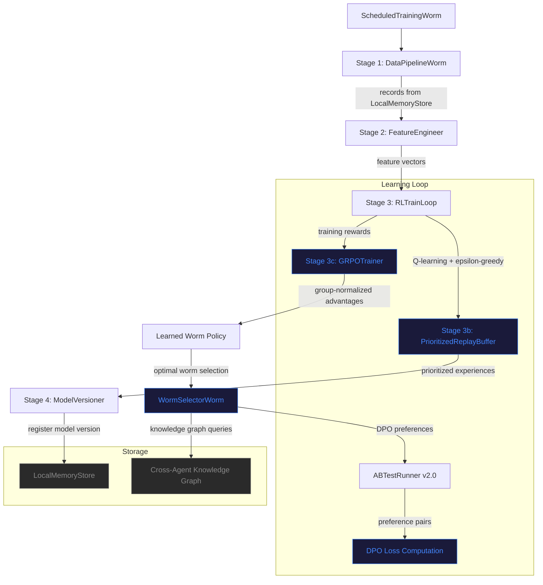
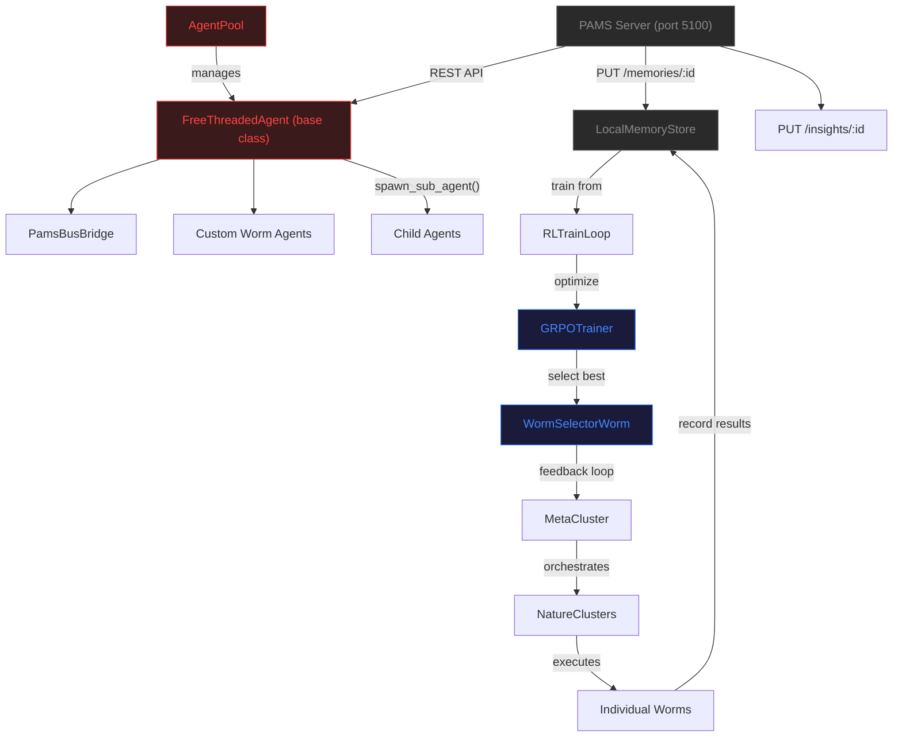
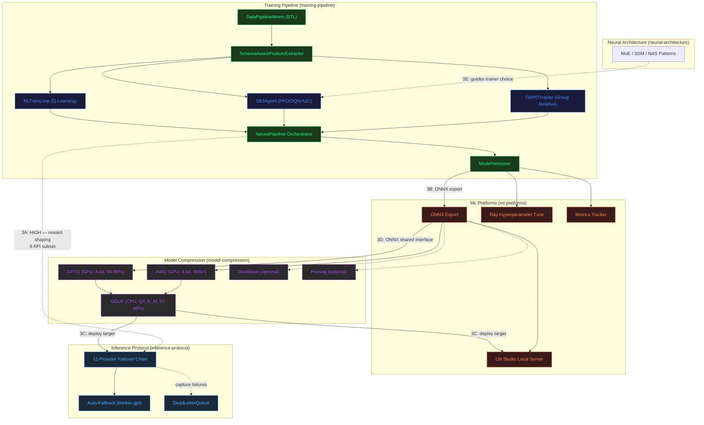
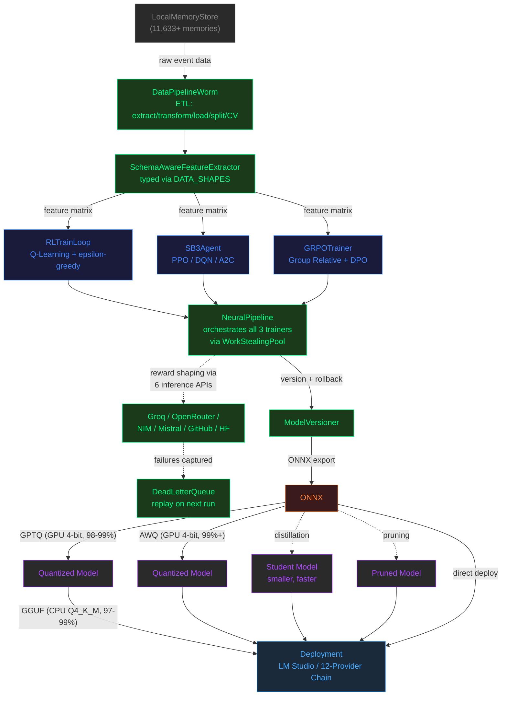
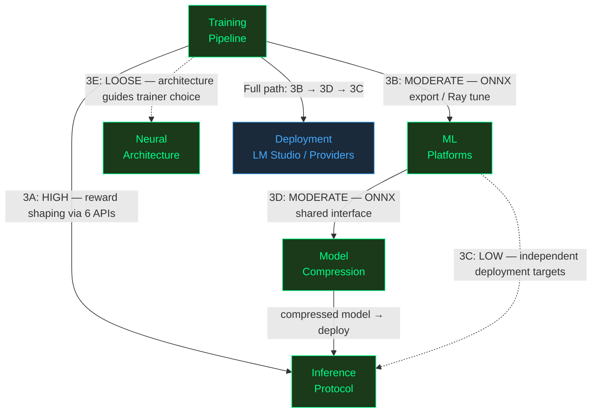

# Azazael Architecture — Mermaid Graphs

## System Architecture (graph TD)

```mermaid
graph TD
    User["User / CLI"] --> MC["MetaCluster Orchestrator"]
    MC --> NCM["NatureClusterManager"]
    NCM --> NC_SEC["NatureCluster: security"]
    NCM --> NC_MON["NatureCluster: monitor"]
    NCM --> NC_DIAG["NatureCluster: diagnostic"]
    NCM --> NC_ORCH["NatureCluster: orchestration"]
    NCM --> NC_LEARN["NatureCluster: learning"]
    NCM --> NC_UTIL["NatureCluster: utility"]
    NCM --> NC_ANAL["NatureCluster: analysis"]
    NCM --> NC_ML["NatureCluster: ml"]

    NC_SEC --> VS["VulnScanner p=8"]
    NC_SEC --> PA["PortAuditor p=7"]
    NC_SEC --> CM["CertMonitor p=6"]
    NC_SEC --> FA["FirewallAudit p=5"]
    NC_SEC --> PS["PermissionScanner p=5"]

    NC_MON --> SZ["SystemZ p=8"]
    NC_MON --> NZ["NetworXZ p=7"]
    NC_MON --> PZ["ProcessZ p=6"]
    NC_MON --> DK["DiskZ p=5"]
    NC_MON --> SMART["SmartDisk p=5"]
    NC_MON --> OS["OSCongruency p=6"]

    NC_ORCH --> MC2["MetaCluster p=10"]
    NC_ORCH --> NC2["NatureClusters p=9"]
    NC_ORCH --> CW["ClusterWORMZ p=7"]
    NC_ORCH --> CONC["Concurrency p=7"]
    NC_ORCH --> FLEET["WormFleet p=6"]

    NC_LEARN --> RL["RLTrainLoop p=6"]
    NC_LEARN --> DP["DataPipelineWorm p=5"]
    NC_LEARN --> MV["ModelVersioner p=5"]
    NC_LEARN --> AB["ABTestRunner p=4"]
    NC_LEARN --> FE["FeatureEngineer p=5"]
    NC_LEARN --> GRPO["GRPOTrainer NEW"]
    NC_LEARN --> PRB["PrioritizedReplayBuffer NEW"]
    NC_LEARN --> WS["WormSelectorWorm NEW"]

    NC_DIAG --> DW["DiagnosticWorm p=5"]
    NC_DIAG --> ERR["ErrorScanWorm p=4"]
    NC_DIAG --> MORPH["MorphingWorm p=4"]
    NC_DIAG --> NETD["NetworkDiag p=7"]

    NC_ML --> SML["SystemZ_ML p=6"]
    NC_ML --> WML["WormZ_ML p=5"]

    NC_ANAL --> BINA["BinaryAnalysis p=6"]
    NC_ANAL --> REVS["ReverseTools p=6"]
    NC_ANAL --> CINS["ClusterInspector p=5"]

    NC_UTIL --> WORMZ["WormZ p=5"]
    NC_UTIL --> OMNI["OmniWorm_V2 p=4"]
    NC_UTIL --> MORPH2["MorphingWorm_V2 p=4"]

    MC --> CNR["CrossNatureRoutingEngine"]
    CNR --> |"46 routes, 264 paths"| NC_SEC
    CNR --> NC_MON
    CNR --> NC_DIAG
    CNR --> NC_ORCH

    subgraph "Infrastructure"
        WR["WORM_REGISTRY (77 worms, 17 categories)"]
        LMS["LocalMemoryStore (SQLite, 1100+ entries)"]
        PAMS["PAMS Bus (51 insights, 133 memories)"]
        FTA["FreeThreadedAgent (Python 3.14t)"]
        SDE["SpawnDiversityEngine"]
        KGRAPH["Knowledge Graph (agent_patterns)"]
    end

    MC --> WR
    NC_LEARN --> LMS
    NC_LEARN --> PAMS
    FTA --> |"base class"| MC
    SDE --> |"weighted selection"| NCM
    KGRAPH --> |"cross-agent patterns"| NC_LEARN

    classDef ok fill:#1a3a1a,stroke:#00ff88,color:#00ff88
    classDef new fill:#1a1a3a,stroke:#4488ff,color:#4488ff
    classDef infra fill:#2a2a2a,stroke:#666666,color:#888888
    class GRPO,PRB,WS new
    class WR,LMS,PAMS,FTA,SDE,KGRAPH infra
```

## ML Training Pipeline (graph TD)

## Agent Hierarchy (graph TD)

## Neural Integration Architecture (graph TD)

## Neural Data Flow — End-to-End Pipeline (graph TD)

## Coupling Map — Integration Points (graph TD)

## Key Numbers
- 5 interconnected neural systems across integration architecture
- 4 deployment scenarios: Full, Compressed, Distillation, NAS
- 5 coupling points (3A HIGH, 3B MODERATE, 3C LOW, 3D MODERATE, 3E LOOSE)
- 12-provider failover chain with auto-fallback
- 6 inference APIs used during training for reward shaping
- 2 training-to-deployment paths: compressed (3 steps) and direct (2 steps)
