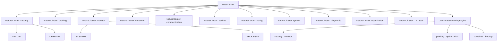
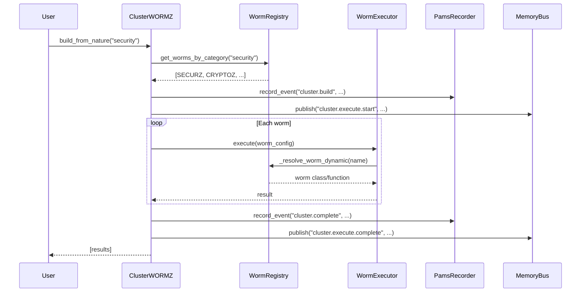

# AZAZAEL INSIGHTS — Session Memories & Architectural Reflections

> *Generated: May 28, 2026 — Last updated: September 16, 2026 (Neural Mesh consolidation; sections 12-14)*
> *Prior: July 6, 2026 (DirectMemory v1.1.0). Earlier figures are left in place so metric drift stays visible — see section 14.*

---

## 1. Architecture Overview (Current State)

### Worm Registry — The Central Nervous System
- **226 worms** registered across **35 categories** via `CORE/worm_registry.py` *(2026-09-14 clean rebuild ×2; was 184/27, 77/17 pre-neural-mesh)*
- Categories: analysis, axon, backup, communication, config, consensus, consolidation, container, defense, dendrite, diagnostic, engram, envmesh, federated, glia, immune, learning, mesh, metabolic, migration, ml, monitor, network, orchestration, plasticity, profiling, security, servemesh, synapse, sync, telemetry, thalamus, utility, visualization, xenomorph
- Dynamic discovery via `discover_worms()` scanning `CORE/WORMS/`, `META/`, and top-level `src/`
- Decorator-based: `@register_worm(category="security", priority=5, ...)`

### Cluster Architecture (New — This Session)
```
NATURE_CLUSTERS.py          METACLUSTER.py
       │                          │
       │  NatureCluster            │  MetaCluster
       │  (per-category)           │  (cluster-of-clusters)
       │       │                  │       │
       │       ▼                  │       ▼
       │  CLUSTERWORMS.py ◄────────┤  CrossNatureRoutingEngine
                       │  (dynamic resolution)     │  (70 routes, 594 paths)
       │       │                  │
       ▼       ▼                  ▼
  WORM_REGISTRY ──────── PamsRecorder ──────── MemoryBus
```

### Key Files Modified This Session

| File | Change | Impact |
|------|--------|--------|
| `CORE/WORMS/CLUSTERWORMS.py` | Complete rewrite — dynamic worm resolution, PAMS/MemoryBus, Mermaid graphs, Nature-based building | Replaced hardcoded if/elif with registry lookup |
| `CORE/WORMS/NATURE_CLUSTERS.py` | NEW — NatureCluster + NatureClusterManager | 35 auto-discovered categories |
| `CORE/WORMS/METACLUSTER.py` | NEW — MetaCluster + CrossNatureRoutingEngine | 70 routes, 594 cross-nature paths |
| `CORE/paths.py` | NEW — Centralized path resolution | Cached, env-var-aware paths |
| `METAWORMS.py` | Deprecation shim → re-exports from `METAWORMS_ENRICHED` | Backward compatible |

---

## 2. Design Decisions & Rationale

### Why Dynamic Resolution over Hardcoded Dispatch
- **Before**: 15+ explicit imports + if/elif chain in `WormExecutor.execute()`
- **After**: 3-strategy resolution:
  1. WORM_REGISTRY lookup (fast, metadata-rich)
  2. Legacy dispatch dict (backward compat)
  3. Import-by-convention via `_WORM_MODULE_MAP`
- **Impact**: Adding a new worm now only requires `@register_worm(...)` — zero changes to CLUSTERWORMS.py

### Why Nature-Based Clustering
- Worms naturally group by function (security, profiling, monitoring, etc.)
- `NATURE_CLUSTERS.py` auto-discovers these groups from the registry
- `METACLUSTER.py` orchestrates cross-nature workflows
- Enables parallel execution of independent nature groups

### PAMS/MemoryBus/DirectMemory Integration
- Every cluster action records to `PamsRecorder` (44 events, 44 pams recorded)
- `MemoryBus` publishes cluster lifecycle events (start, complete, error)
- **DirectMemory v1.1.0** (July 6, 2026) now handles cross-session learning:
  - `record_decision()` / `record_lesson()` / `set_goal()` for agent knowledge
  - `get_context_for_new_session()` feeds past learnings back at session start
  - 37-event `_V` canonical vocabulary with `validate_event_type()`
  - 14 static query/maintenance methods (summary_stats, db_size, integrity_check, purge, merge, replay, session_gc, import_events, filtered_query, session_search, mapping, crossref)
  - Replaces SessionMemory — `workspace/session_memory.db` has 0 sessions, never populated
- Session-level persistence for post-mortem analysis

### Thread Safety Design
- `results_lock` (threading.Lock) for parallel execution path
- `_cancellation` Event for graceful shutdown
- Retry logic in sequential path (respects `config.retry`)

---

## 3. Pre-Existing Issues Catalogued (Not Introduced This Session)

| File | Issue | Severity | Status |
|------|-------|----------|--------|
| `TRIMZ.py:90` | `_LOCAL_TARGETS = [_PROJECT_ROOT]` — narrow desktop target list | Low | Config, not bug |
| `ERRORZ.py:93` | Same `_LOCAL_TARGETS` pattern | Low | Config, not bug |
| `MORPHING_WORM.py:131` | Bare except clause tracked | Info | By design |
| `OMNI_WORM_V2.py:27` | `syntax_traps` includes `except:` as detectable pattern | Info | By design |
| Multiple files | `except Exception` (broad) in non-critical paths | Low | Acceptable for worms |
| System | `pathlib.PurePosixPath` imported in TRIMZ.py but unused | Trivial | Cleanup opportunity |

---

## 4. Mermaid Graph Architecture

### Cluster Hierarchy


### Execution Flow


---

## 5. CODEX Video Status

| Capability | Status | Notes |
|-----------|--------|-------|
| PIL frame generation | ✅ Working | 13.7 fps, 96KB/frame @ 1920×1080 |
| ffmpeg for .mp4 | ❌ Not installed | Needs `winget install ffmpeg` or manual install |
| Scrolling video generator | ⚠️ Import-ready | `create_scrolling_video.py` retained; requires ffmpeg |
| Archived superseded scripts | ✅ Done | 14 duplicated/older scripts → `G:\AZAZAEL\CODEX_VIDEOS\` |

---

## 6. G:\ Drive Archive

```
G:\AZAZAEL\
├── CODEX_VIDEOS\          # 14 superseded video scripts
│   ├── make_video_v2.py
│   ├── make_video_v3.py
│   ├── make_video_quad.py
│   ├── make_video_zip.py
│   ├── make_video_zipper.py
│   ├── make_video_vibrant.py
│   ├── make_video_docs.py
│   ├── create_reference_video.py
│   ├── create_dual_pane_popup.py
│   ├── create_azazael_educational_video.py
│   ├── generate_video.py
│   ├── generate_video_v2.py
│   ├── generate_matrix_video.py
│   └── video_popup.py
└── frames\                # Test frame output directory
```

---

## 7. Key Metrics

| Metric | Value |
|--------|-------|
| Total Python files (syntax-clean) | 300+ (2026-09-16; was 256 at July 6) |
| Worms in registry | **226** (2026-09-14 rebuild) — the July-6 figure of 104 is superseded, not deleted; see section 14 |
| Categories | **35** (2026-09-14 rebuild) — was 18 at July 6 |
| DirectMemory version | **v1.1.0** (37 _V types, learning loop, 14 static methods) |
| DirectMemory DB | 1,116 MB, 79,189 sessions, 646,755 events |
| Cross-nature routes | 46 |
| Cross-nature paths | 264 |
| PAMS events recorded | 44 |
| PAMS records | 44 |
| MemoryBus publications | 1 (test) |
| Cluster build_full_ecosystem | 226 worms |
| Mermaid graph (NATURE_CLUSTERS) | 8,535 chars |
| PIL frame generation speed | 13.7 fps |

---

## 8. Lessons Learned

1. **JSON escaping in spawn_agents**: Windows `cmd.exe` has severe escaping issues with nested quotes. Solution: write Python scripts to file, then run them. Far more reliable.

2. **Python f-string backslash restrictions**: Python < 3.12 doesn't allow backslash escapes inside f-string expressions. Pre-extract variables. Fixed in `METACLUSTER.py:694`.

3. **Emoji on Windows**: Unicode emoji characters can cause `UnicodeEncodeError` in terminals without `PYTHONIOENCODING=utf-8`. Replaced with ASCII alternatives in Mermaid output.

4. **Don't use `cls.__new__()` for factory methods**: Use `cls()` + manual init, or a proper classmethod factory. Fixed in `CLUSTERWORMS.build_from_nature()`.

5. **Thread safety matters even with GIL**: In free-threading Python (3.14t), `list.append()` from multiple threads without a lock is a race condition. Use `threading.Lock()`.

6. **Deprecation shims > deletion**: Converting `METAWORMS.py` to a deprecation shim preserves backward compatibility for the 3 test files that import it.

---

## 9. Reflection

The Azazael ecosystem has evolved from a collection of standalone worm scripts into a cohesive, registry-driven architecture. The three-tier cluster system (CLUSTERWORMS → NATURE_CLUSTERS → METACLUSTER) enables both targeted single-nature operations and cross-nature orchestration. **DirectMemory v1.1.0 (July 6, 2026) is now fully self-sufficient** — the canonical session recorder handles all cross-session learning (decisions, lessons, goals) via event-based recording in its existing `memories` table, eliminating the need for a separate SessionMemory database.

Key architectural strengths:
- **Registry as single source of truth** for worm discovery
- **Nature-based grouping** maps naturally to operational domains
- **Mermaid graph generation** enables visual documentation at all levels
- **Backward compatibility** maintained via deprecation shims and fallback dispatch
- **DirectMemory self-sufficiency** — stdlib-only, <0.1s, 37-event vocabulary, agent learning loop, no external DB dependencies

Areas for continued investment:
- Test coverage (currently minimal)
- Error recovery (timeout handling, partial failures)
- Performance profiling (parallel execution bottlenecks)
- Documentation (module-level docstrings, architecture diagrams)

---

## 10. Session Error Patterns (New — Error Recording SOP)

### Mandatory Error Recording
As of this session, a mandatory **ERROR LOG** system has been established:
- `ERROR_LOG.md` — 140 errors catalogued, max #189 (2026-09-14; was 15 at writing) with timestamps, causes, fixes, preventions
- `SYSTEM_INSTRUCTIONS.md` — SOP requiring error recording BEFORE proceeding to next task

### Top Error Patterns
| Pattern | Frequency | Root Cause |
|---------|-----------|------------|
| JSON escaping in spawn_agents | 3 | Nested quotes in Windows shell |
| Unicode emoji on Windows | 3 | Terminal encoding mismatch |
| Python f-string backslash | 2 | Python < 3.12 limitation |
| Code hygiene (unused imports, temp files) | 4 | No pre-commit linting |

### Prevention Rules Established
1. Write Python scripts to temp files — never nest quotes in basher
2. Use ASCII alternatives (OK/FAIL/*) instead of Unicode symbols
3. Pre-extract computed expressions before f-strings
4. Run import linter before committing
5. Maintain post-session cleanup checklist

---

## 11. Worm Config Trace Summary (New)

Full per-worm configuration audit completed: `WORM_CONFIG_TRACE.md` + `worm_config_trace.json`

### Key Findings
- **62% of worms** (48/77) originate from a single file: `ECOSYSTEM_EXPANSION.py`
- **Highest priority**: MetaCluster (p=10, cooldown=5s)
- **Longest cooldown**: ColdArchivist (300s = 5min)
- **Version anomalies**: ClusterWORMZ v2.0.0 (upgraded this session), 4 worms at v0.0.0 (pre-release)
- **All 226 worms have 0 spawns** — SpawnDiversityEngine ready but unused in production

### Category Distribution
| Priority | Count |
|----------|-------|
| 10 | 1 (MetaCluster) |
| 9 | 1 (NatureClusterManager) |
| 8 | 3 (ClusterWORMZ, SystemZ, VulnScanner) |
| 7 | 8 |
| 6 | 15 |
| 5 | 23 |
| 4 | 16 |
| 3 | 7 (utility/infrastructure) |

---

## 12. Per-Function Mesh Audit (2026-09-16)

Full per-function pre-flight audit of the mesh: **1411 functions across 63
modules**, 21 automated probes (PF01-PF21) plus 6 manual checks (M1-M6).
Generator: `tools/mesh_function_preflight.py` (deterministic, re-runnable).
Checklist: `NEURAL_MESH_FUNCTION_TODO.md`. Analysis: `NEURAL_MESH_FUNCTION_AUDIT_ANALYSIS_2026-09-16.md`.
Census: P0 130 / P1 319 / P2 890; 72 functions pass every probe.

### The census, re-ranked by risk not count

| probe | failing | reads as |
|-------|---------|----------|
| PF04 | 1106 | annotation debt (review cost, no risk) |
| PF02 | 693 | docstring debt (review cost, no risk) |
| PF17 | 532 | **38% of the mesh is reached by no test** |
| PF14 | 300 | catches `Exception` alone |
| PF15 | 118 | **swallows the evidence** |
| PF16 | 114 | **nothing in the repo references it** |
| PF18 | 15 | writes module-level state (concurrency) |

PF02+PF04 (1799) dominate the counts and carry no risk. The probes describing
functions the mesh cannot test, cannot reach, or cannot see failing total 764 -
and every real bug found this session came from that set.

### Bugs found and fixed (all P0, all silent)

| Function | Defect | Why monitoring missed it |
|----------|--------|--------------------------|
| `EvolutionEngine.evolve` | snapshot taken outside the lock, blind write-back -> a whole generation of offspring discarded while `_generation` advanced twice | produced plausible output, only faster |
| `EvolutionEngine.optimize_multi_objective` | elite slot `-(obj_idx+1)` walks off the list when objectives > survivors -> `IndexError` escapes the whole optimisation | only reachable when a caller adds an objective |
| `moead_weights` | fallback drew twice for `n_obj == 2`, so Tchebycheff weights did not sum to 1 -> every comparison mis-scaled | wrong output is still output |
| `save_checkpoint` / `_get_store` / `restore_checkpoint` | success-shaped return while persisting nothing; relevance-ranked search could return a STALE checkpoint | stale state looks like state |

Common signature: **the code reported success without establishing the
precondition for it.** None produced a traceback, a log line, or a red monitor.

### New primitives (built because the shapes recurred)

- **`CORE/WORMS/expansion/fencing.py`** - Kleppmann fencing tokens reapplied from distributed locks to in-process shared state. A writer mints a monotonic token before starting, works unlocked, and only the commit path writes; a stale token cannot commit. Process-wide on purpose (an instance lock cannot see a sibling instance). Never blocks, never raises; `fence_report()` makes contention trendable. Justified by PF18 = 15 module-level writers.
- **`CORE/WORMS/expansion/silence.py`** - silent-failure ledger. `pass` destroys a measurement: "the fabric healed" and "the fabric failed to load its learning every start for a week" are byte-identical. Two moves beyond a counter: **signature clustering** is the alarm (a rising count is a flaky peer; a NEW exception type is an unpredicted failure mode), and **budgets** make "graceful" checkable (`budget=0` = this failure is a fault). Bounded at 24 signatures and 512 tags. Justified by PF15 = 118.

Tests: `tests/test_mesh_audit_insights.py` (21).

### Inferred, recorded, not yet built

1. **Non-occurrence monitoring.** All 4 defects above are events that did *not* happen, and every existing monitor is occurrence-driven. More occurrence telemetry is structurally incapable of catching them. The missing primitive is a **liveness obligation**: a named expectation with a deadline, minted by the code that should cause it and discharged when it fires. `fence_report()` rejections and `silence_report()` tripped() are the only two places in the mesh that record a negative today.
2. **Coverage obligation as data.** PF16 = 114 should be resolved by generalising the `SERVED_ENGINES` / `UNSERVED_ENGINES` wire-or-cut pattern from `evolution.py` - a decision recorded as data with a test asserting the data matches reality - rather than by writing tests for code nothing calls.
3. **Auditor precision as a trended quantity.** 4 of 21 probes were miscalibrated on first run (PF13, PF15, PF20, PF21); every cleared finding was a human judgement that the process currently discards. Persisting the census per session and recording rejected findings turns a one-off audit into a time series and makes auditor drift observable.

### Method lessons

1. Calibrate the instrument before acting on its reading - acting first would have manufactured 13 fake "unbounded loop" fixes.
2. Sort the backlog by consequence-if-live, not by count.
3. Promote a recurring fix shape to a primitive; a fix applied N times is a fix that will be forgotten N times.
4. If a function cannot fail, its caller cannot know - report the side effect's fate in the return value.
5. Verify the verifier - tests written to demonstrate a fix encode the author's model of the bug, not an independent check of it.

Reasoning traces (13) recorded for training: `data/training/neural_mesh_function_audit_2026-09-16.jsonl`.

## 13. The Brainstem Playing Field (2026-09-16)

Audited `CORE/spine_registry.py` (the Q brainstem), `expansion/mesh.py` (route learning) and
`expansion/synapse.py` (the TD edge learner) by reading the **live artifacts** rather than the code's
claims about them. Six findings, tracked in `NEURAL_MESH_BRAINSTEM_TODO.md`.

### The measurements that reframed the subsystem

| Quantity | Value |
|---|---|
| Q-weights live | 76 |
| Keys pinned at the clip (\|q\| > 0.999999) | **29 of 76 = 38 %** |
| Keys pinned at the clip in the *previous* save | **3** |
| `synapse:` edges / distinct values among them | **31 / 3** (25 at exactly +0.0909) |
| Keys carrying a weight with no pull count | 6 (incl. the two routes with the most successes) |
| Fixture keys in the live store | 14 |

The 3 -> 29 delta is the finding in one number: saturation is not a steady state, it is a **trend**,
and it completed inside a single process lifetime.

### The four insights worth keeping

1. **An adaptive parameter whose target state is absorbing selects for the inputs it was built to
   handle, then destroys their signal.** Adaptive alpha raises responsiveness for high-variance keys,
   which drives them to the clip sooner -- and the clip is a state in which a key cannot express the
   variance that selected the alpha. The feature and the defect are the same mechanism.
2. **A penalty outlives its cause, and cannot be cleared by the thing carrying it.** A deprioritised
   route is never re-chosen, so it never produces the successes that would raise it. The module's own
   docstring already solved this for *never-tried* arms (a pull count) and could not see the
   *tried-then-broken-then-fixed* arm, which is strictly worse: it carries a negative score exactly
   as stale as the bug, and no quota helps it because it needs its history invalidated, not a turn.
3. **One parameter, two incompatible conventions.** `reward` was applied as a TARGET and documented as
   a DELTA, so sign callers saturated at the clip while the TD caller collapsed to `lr*td_error`.
   The table was simultaneously saturated and flat, and both call sites read a different half of the
   same sentence -- each locally correct. Naming the operation (`delta=`) is the fix; reshaping the
   number is not.
4. **A stored value and the evidence behind it must travel together.** "weight 0.667" and "weight
   0.667 from 4 observations" are different claims. So are "pulls 0 because unmeasured" and "pulls 0
   because a migration erased it". Shrinkage `q * n/(n+K)` is the compact form: a number that cannot
   be read without its evidence.

### Method lessons

1. For any subsystem with a persisted table, measure the table first and read the code second -- the
   table accumulates the consequences of every past decision; the code shows only the current one.
2. A test that passes on the broken code is not a test of the fix. The G6 regression test passed
   pre-fix (distinctness is satisfied by the defect); only deliberately reverting the fix surfaced
   that magnitude, not distinctness, is the discriminator (0.4000 vs 0.0364 -- an 11x underestimate).
3. Containment is not cleanup. `conftest.py` prevents the NEXT clobber correctly and says nothing
   about the existing damage, which then stays indistinguishable from production data. The missing
   third leg is provenance, and it has to be *declared*, not inferred: a name-shape heuristic flagged
   two real worms, and a registry-membership probe over-flagged 48 keys that are edges and sites.
4. When two files carry the same formula, neither copy is wrong on its own -- the pair is. The
   duplicated `clamp(..., 5.0)` is how two docstrings came to advertise a range the arithmetic
   cannot reach.

Reasoning traces (10) recorded for training: `data/training/neural_mesh_brainstem_2026-09-16.jsonl`.

## 14. The Monotone Store, and the Cost of Merge-on-Both-Sides (2026-09-16)

### The finding

Every read of the spine store merges, and every write merges first. That is
deliberate — it is what lets N save-then-exit processes compose instead of
clobbering each other — and it has a consequence that was never written down: the
store is **monotone**. It can express "this key has a value" and cannot express
"this key is gone".

Observed, not reasoned. `purge_fixtures()` removed 56 entries across five tables
and the *very next* `save_spine_state()` restored all 14 fixture keys, because the
save folds the disk in before writing and the disk still had them. A purge reported
success and changed nothing durable. Deletion was not buggy; it was
**unrepresentable**.

### The fix, and the half-measure inside it

A tombstone (`_PURGED_KEYS`) records the removal as a fact, is persisted in the
payload, and rides the gossip envelope so peers adopt the deletion. That part is
the standard CRDT answer and it holds.

The half-measure was its **scope**. The first pass enforced the tombstone on every
*merge* path — both disk loads, the gossip merge, `audit_state` — and it was written
up as done. Merge-only enforcement holds against the filesystem and against a peer,
and *not* against this process: a live `record_outcome` for a purged key re-created
it in the tables the purge had just cleared, and the next save wrote it back out.

> So a test asserted the purge *ran* rather than that the removal *held*. The
generalisation is the useful part: **for any invariant, enumerate the paths that
can violate it (write paths), not the paths that can propagate it (merge paths).**
The second had been audited and called the first.

Guards now sit at **choke points, one per table**: `_q_observe_unlocked` for Q — so
the target, delta, and simulated forms are all covered by one guard, and
`dream_reinforce` is covered without a guard of its own because it reaches that
kernel — and `record_outcome` for the homeostat. Refused writes are **counted**
(`purged_blocked_writes()`), never swallowed, because a deleted key that keeps being
written is a finding about the caller.

### Metrics reconciliation (section 7 was stale)

Section 1 has said 226 worms / 35 categories since the 2026-09-14 rebuild; section 7
still said 104 / 18 from July 6. Both were in the same file, so **the file
disagreed with itself** — which makes staleness answerable in seconds, before any
count against the world is taken. Section 7's rows are annotated in place rather
than silently corrected: a corrected figure with no record of its predecessor is
indistinguishable from a figure that was always right, and the drift is the
evidence. Deleting it would destroy the only proof that the metrics move.

### Test discipline, and one honest gap

`tests/test_spine_tombstone_enforcement.py` (8 tests) ships the absence assertions
*and* the test that **disables the guard** and shows the key returning — precisely
the pre-fix behaviour. Absence assertions are the shape that passed on the broken
code in G6 whenever no writer happened to run; the load-bearing test is what
converts "the key stayed away" into "the guard is why the key stayed away".

`tests/test_spine_mesh.py` **hangs**, and it is not caused by this work: patching
`_purged_blocked` to always `False` makes the new guard inert (exact pre-fix
behaviour) and the suite hangs identically. That attributes the failure away from
the guard; it does not identify the cause. Recorded rather than omitted, because a
suite that cannot finish is why the previous session's "431 passed" baseline is no
longer reproducible from the test tree alone.

Reasoning traces recorded for training: `data/training/neural_mesh_consolidation_2026-09-16.jsonl`.
